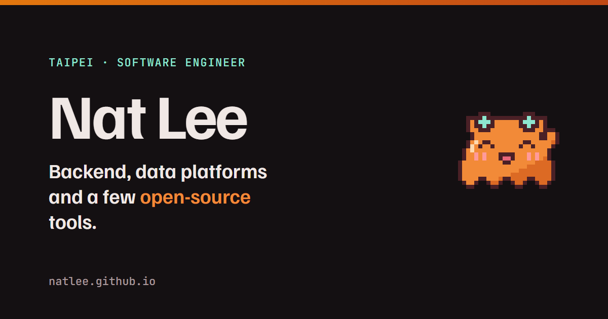

# natlee.github.io

Nat Lee's personal site: one body of content, several looks.

- **Live:** https://natlee.github.io (theme: Persimmon)
- **Other looks:** https://natlee.github.io/valhalla/



## How it fits together

```
content/                      ← the only place content is edited
  personal.json  projects/*.json  experience.json  mascots.json  …
      │
      ├─ npx next build ──► Persimmon (static HTML, the main site)
      │                 └─► /content/site.json
      │                          ▲
      └──────────── read at runtime by every Valhalla theme
                     Aerial · Bonfire · Flat · Terminal · Stonk
```

Adding a project means editing one JSON file and pushing once. The main site is rebuilt, and every other theme picks the change up the next time it loads. Themes are only rebuilt when their own code changes.

## Pages (Persimmon)

| Page | What it shows |
|---|---|
| `/` | Who I am, Telepy, live playground, selected work, open source, career eras, how I work, writing |
| `/projects` | All projects with search, theme and live-demo filters; filters can be shared as URLs |
| `/projects/telepy` | Case study: architecture, features, the Django → Rust benchmarks |
| `/about` | The longer story, languages, contact |
| `/experience` | Work, education, skills and upstream contributions; prints as a CV |
| `/valhalla` | The other themes |

English and Traditional Chinese, light and dark. The mascots are Tapi (from [Telepy](https://github.com/NatLee/telepy)) and Chiyo (from the 2015 Aerial page).

## Valhalla

| Theme | Since | Look |
|---|---|---|
| Aerial | 2015 | HTML5 UP "Aerial", a live wind map, Chiyo talking in the corner |
| Bonfire | 2018 | Link tiles under a pixel bonfire |
| Flat | 2025 | First Next.js look |
| Terminal | 2026 | The whole site as a zsh session |
| Stonk | 2026 | Trading-terminal experiment |

How themes work and how to change one: [`themes/README.md`](./themes/README.md).

## Develop

```bash
npm ci             # Node.js 22+
npm run dev        # http://localhost:3000
npm test           # content, asset and shared-filter checks
npm run build      # type-check + static export to out/
```

These commands work on Windows and Unix. Pull requests run the checks and static build; pushes to `main` also deploy to GitHub Pages.

```bash
node scripts/sync-github.mjs                 # refresh star counts (CI does this on deploy)
node scripts/make-thumbs.mjs                 # card thumbnails after adding a project
node scripts/valhalla/build-theme.mjs <name> # rebuild a theme after changing its code
```

Content lives in `content/` (with JSON Schemas for editor autocomplete); UI strings in `messages/`. `content/playground.json` chooses the live projects on the homepage; every entry needs a `links.demo` URL. Local WebP covers keep project images available without third-party image hosts. See [`CLAUDE.md`](./CLAUDE.md) for conventions.
